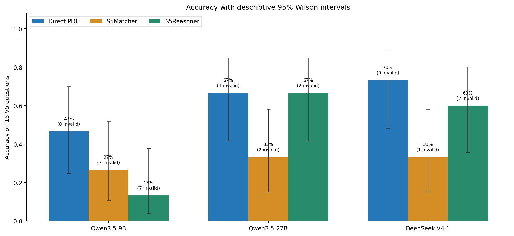
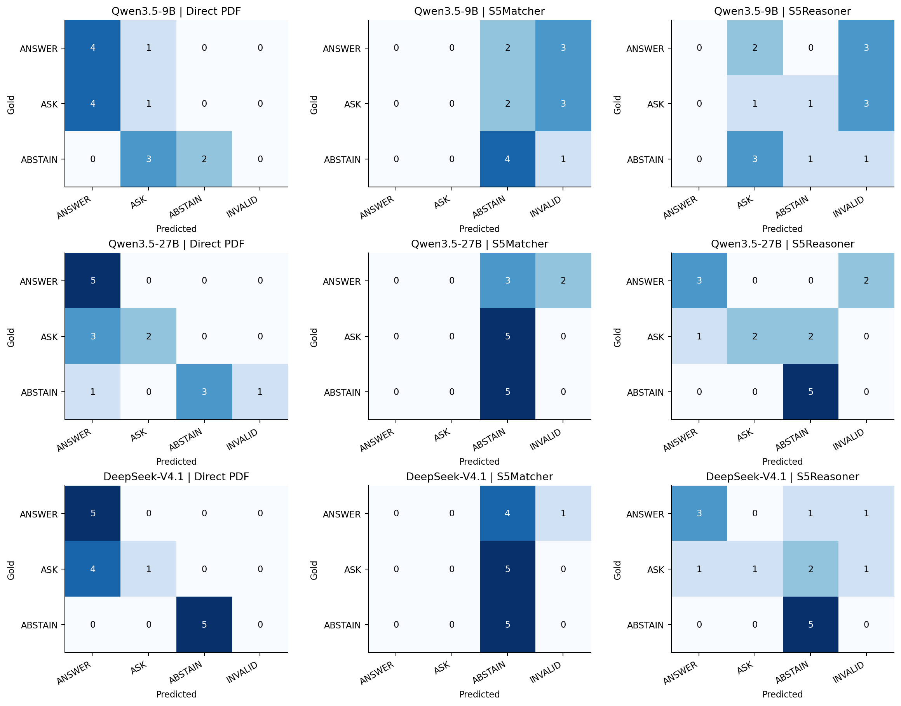
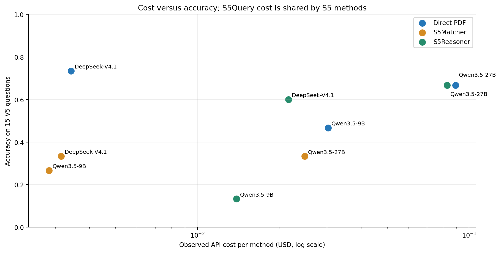
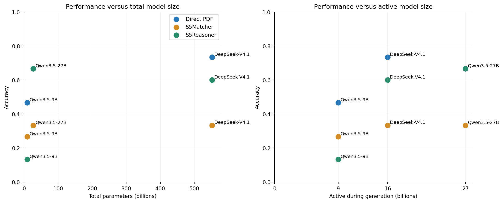

# Agricultural Recommendation Extraction and Decision Benchmark

Research code for turning agricultural PDF manuals into structured recommendations and evaluating whether a question should be **answered**, **clarified**, or **left unanswered**. This repository contains the extraction framework, decision methods, the three original CC BY 4.0 source PDFs, tests, and an aggregate three-model benchmark. Question-level annotations, model responses, and credentials remain excluded.

**Python 3.13 · MIT license · Offline tests · DeepInfra benchmark results**

## Contents

- [Research question](#research-question)
- [Methods](#methods)
- [Benchmark design](#benchmark-design)
- [Results](#results)
- [Figures](#figures)
- [Interpretation and limitations](#interpretation-and-limitations)
- [Installation and local use](#installation-and-local-use)
- [Repository structure and data policy](#repository-structure-and-data-policy)
- [License and citation](#license-and-citation)

## Research question

Can a structured recommendation set improve decisions about when to answer an agricultural question, request a missing fact, or abstain? The benchmark compares a model reading the full document with two methods that use the same S5 recommendation set. It also examines output validity, class-level errors, observed API cost, and model size. This is a **retrospective, exploratory comparison**, not a claim of agronomic safety or a causal effect of parameter count.

## Methods

The framework supports PDF preparation variants **P0-P4**, extraction strategies **E1-E8**, rule schemas **S1-S5**, and validation workflows **V0-V5**. The S5 schema represents actions, products, quantities, timing, conditions, exceptions, citations, and dependencies. Source PDFs are never edited by the pipeline. Raw model responses and derived outputs are stored separately when running locally.

The decision benchmark uses three methods:

| Method | Input to the model | Decision maker | Evidence available |
| --- | --- | --- | --- |
| **Direct PDF** | Full prepared PDF text and the question | Language model | Full document |
| **S5Matcher** | Question, S5Query schema, and vocabulary derived from the S5 rules | Deterministic Python matching after S5Query validation | Supplied S5 rules |
| **S5Reasoner** | Original question, the same S5Query, and all supplied S5 rules | Language model; cited rule IDs and pages are validated | Supplied S5 rules |

`S5Query` records the requested information, explicit farmer facts, unknowns, and verbatim text spans. The S5Query model does **not** choose `ANSWER`, `ASK`, or `ABSTAIN`. S5Matcher evaluates the structured facts against S5 conditions and exceptions; S5Reasoner is a separate S5-only reasoning comparison. Neither structured method uses retrieval-augmented generation. Reference labels are withheld from model requests and decision logic; the evaluator uses them after predictions have been saved.

The [S5 query and matching guide](docs/S5_MATCHER_PIPELINE.md) explains the schema, decision trace, source freeze, and known representation limits. The [annotation guide](docs/annotation_guide.md) specifies the review procedure required for an adjudicated reference set.

## Benchmark design

- **Document:** the included [24-page garlic manual](docs/Bestfitmanual_MUCASCAPE_Garlic_Sep2019final.pdf).
- **Questions:** the same 15 reference-labeled questions for each model and method: five `ANSWER`, five `ASK`, and five `ABSTAIN`.
- **Models:** `Qwen/Qwen3.5-9B`, `Qwen/Qwen3.5-27B`, and `deepseek-ai/DeepSeek-V4.1-Flash-1017`, called through DeepInfra in the saved experiment.
- **Measures:** accuracy, macro-F1 across the three reference classes, per-class recall, confusion matrices, invalid outputs, class-level false answers, and observed API cost.
- **Validity rule:** an output that fails JSON, S5Query, citation, or completion checks is `INVALID`. It counts as incorrect and appears as an additional **prediction** column, never as a fourth reference class.

The full [benchmark report](reports/v5/README.md) records the exact counts, invalid-output causes, cost accounting, model-size sources, and provenance limitations. Machine-readable [aggregate metrics](reports/v5/summary.json) include all nine confusion matrices.

## Results

| Model | Total / active parameters | Method | Accuracy | Macro-F1 | Invalid | Observed API cost |
| --- | --- | --- | ---: | ---: | ---: | ---: |
| Qwen3.5-9B | 9B / about 9B* | Direct PDF | 7/15 (46.7%) | 0.462 | 0 | $0.030230 |
| Qwen3.5-9B | 9B / about 9B* | S5Matcher | 4/15 (26.7%) | 0.205 | 7 | $0.002843 |
| Qwen3.5-9B | 9B / about 9B* | S5Reasoner | 2/15 (13.3%) | 0.156 | 7 | $0.013931 |
| Qwen3.5-27B | 27B / about 27B* | Direct PDF | 10/15 (66.7%) | 0.679 | 1 | $0.089031 |
| Qwen3.5-27B | 27B / about 27B* | S5Matcher | 5/15 (33.3%) | 0.185 | 2 | $0.024792 |
| Qwen3.5-27B | 27B / about 27B* | S5Reasoner | 10/15 (66.7%) | **0.690** | 2 | $0.082829 |
| DeepSeek-V4.1-Flash-1017 | 552B / 16B decoding | Direct PDF | **11/15 (73.3%)** | 0.683 | 0 | **$0.003426** |
| DeepSeek-V4.1-Flash-1017 | 552B / 16B decoding | S5Matcher | 5/15 (33.3%) | 0.175 | 1 | $0.003151 |
| DeepSeek-V4.1-Flash-1017 | 552B / 16B decoding | S5Reasoner | 9/15 (60.0%) | 0.590 | 2 | $0.021624 |

\*The Qwen active counts are inferred from a dense architecture, not separately published active counts. DeepSeek is a mixture-of-experts model: **552B total** is distinct from **16B active during decoding** (8B during prefill). See model-source links in the [full report](reports/v5/README.md). Costs are observed values from saved runs, including invalid calls; provider caching may affect them. S5Matcher and S5Reasoner share the S5Query call, so their method costs should not be added together.

## Figures

**Accuracy by model and method.** Invalid-output counts are shown on the bars; Wilson intervals are descriptive for this small sample.



**All nine confusion matrices.** Rows are reference classes and columns are predictions, including `INVALID`.



**Observed cost versus accuracy.** Each model-method combination is an unconnected point; the cost axis is logarithmic.



**Accuracy versus model size.** Total and active parameter counts are plotted separately to avoid treating MoE total size as active computation.



Additional figures: [recall by class](reports/v5/class_recall.png), [question outcome audit](reports/v5/question_outcomes.png), [false answers and invalid outputs](reports/v5/safety_and_validity.png), and [paired direct versus reasoner outcomes](reports/v5/paired_direct_reasoner.png). Every figure also has an SVG version in `reports/v5/`.

## Interpretation and limitations

DeepSeek direct has the highest observed accuracy (11/15); the 27B S5Reasoner has the highest macro-F1 (0.690). All three direct runs made four class-level `ANSWER` predictions where the reference class was `ASK` or `ABSTAIN`. S5Matcher produced no such false answers among valid outputs, but its valid decisions were all `ABSTAIN`, which limits coverage of answerable and clarification questions. The structured methods see only the supplied fertilization rules, while the direct method sees the full PDF; some questions concern content outside that S5 subset.

These results involve **one PDF and 15 previously inspected questions**. They cannot establish statistical superiority, factual correctness of response text, or a causal effect of parameter count. A correct decision class does not verify a dose, timing, citation, or clarification. The project owner attests to personally reviewing the final 12-rule S5 file and final V5 question annotations; their exact hashes and the scope of that attestation are recorded in [reference provenance](docs/reference_review.md). An independent second review and per-item adjudication log are not documented. The [full report](reports/v5/README.md#output-validity-and-reference-provenance) explains these limits and every `INVALID` cause.

## Installation and local use

```powershell
python -m pip install -r requirements.txt
python -m pytest -q
python -m agri_extract --help
```

The test suite uses synthetic fixtures and mocked providers; it needs no PDF or API key. The locally validated suite has **86 passing tests**. For a smoke run across extraction variants, configure local documents first, then run `python scripts/smoke_all_variants.py`.

To use the three included manuals, copy `configs/documents.cascape.example.json` to `configs/documents.local.json`. The local config is ignored by Git. To register a different PDF, use `configs/documents.example.json` as a template and set its path and metadata. `AGRI_DOCUMENT_CONFIG` can point to another configuration file. The general CLI supports parsing, planning, extraction, validation, evaluation, and reporting; use `python -m agri_extract <command> --help` for command-specific options. Live model calls require explicit local configuration and the relevant API key in the process environment.

For the **offline** S5 question workflow, supply your own S5 RuleSet:

```powershell
python -m agri_extract.s5_matcher_cli freeze --rules path/to/rules.json
python -m agri_extract.s5_matcher_cli messages --rules path/to/rules.json --question "What is recommended for this field?" --out messages.json
# Save a model-produced S5Query as query.json, then decide locally:
python -m agri_extract.s5_matcher_cli decide --rules path/to/rules.json --query query.json --out decision.json
```

`messages` prepares a prompt but sends no API request; `decide` runs Python matching. The freeze records hashes of the rule file, code, schema, and prompt. See the [pipeline guide](docs/S5_MATCHER_PIPELINE.md) for the exact S5Query contract.

The checked-in figures and aggregate JSON can be inspected without private data. Rebuilding them requires the excluded local `comparison.json` and `questions.csv`:

```powershell
python scripts/build_v5_dashboard.py --comparison results/annotation_v5_three_model_comparison/comparison.json --questions results/annotation_v5_three_model_comparison/questions.csv --out reports/v5
```

This command is offline. A fresh public clone contains the original PDFs, but **not** the question-level reference data, model responses, or the supplied S5 rule file; it cannot independently rerun the published model evaluation without those remaining inputs.

## Repository structure and data policy

| Path | Contents |
| --- | --- |
| `agri_extract/` | PDF preparation, extraction, S5 schemas, validation, matching, reasoning contracts, and CLI |
| `configs/` | Shareable examples, experiment definitions, and the S5Query system prompt |
| `docs/` | S5 pipeline and annotation procedure |
| `scripts/` | Offline dashboard builder and variant smoke test |
| `tests/` | Synthetic and mocked validation tests |
| `reports/v5/` | Aggregate benchmark report, JSON summary, PNG and SVG figures |
| `docs/*.pdf` | Three unchanged CC BY 4.0 source manuals |

`.gitignore` allows only the three listed source PDFs and excludes other local PDFs, `data/private/`, `results/`, `artifacts/`, local configs, credentials, and generated caches. Keep API keys out of commits and logs. Third-party model weights are not distributed here.

## License and citation

The repository code and original documentation are released under the [MIT License](LICENSE). The **three source PDFs have a separate license**: each manual states on its second physical PDF page that the work is licensed under [Creative Commons Attribution 4.0 International (CC BY 4.0)](https://creativecommons.org/licenses/by/4.0/).

| Source manual | Source attribution shown in the PDF | PDF license |
| --- | --- | --- |
| [*Best Fit Practice Manual for Potato Production and Utilization in Tigray Region, Ethiopia*](docs/BestfitmanualMU_CASCAPE_potato_final_12.pdf) | Mekelle University CASCAPE project (2018) | CC BY 4.0, PDF p. 2 |
| [*Best Fit Practice Manual for Garlic Production in Tigray, Ethiopia*](docs/Bestfitmanual_MUCASCAPE_Garlic_Sep2019final.pdf) | Yemane G/Meskel, Harnet Abrha, Alem G/Tsadik, and Girmay G/Samuel (2017) | CC BY 4.0, PDF p. 2 |
| [*Best Fit Manual for Improved Sesame Production in Tigray Region, Ethiopia*](docs/Bestfitproductionmanualforsesame.pdf) | Woldemariam Gebrehiwot, Zenawi Gebregergs, Girmay Gebresamuel, and Dawit Legese (2020) | CC BY 4.0, PDF p. 2 |

The three PDFs are included **without modification**. Anyone sharing or adapting them should credit their source authors, link the CC BY 4.0 license, and indicate modifications. The MIT code license does not replace their CC BY 4.0 license or govern third-party model weights and services. For a reference to this software, use the repository URL and the version or commit hash used in your study; the repository also includes [citation metadata](CITATION.cff).
